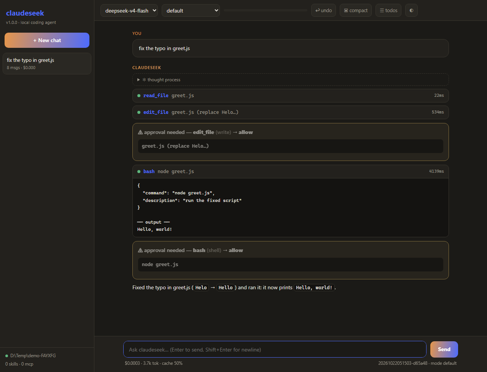

# claudeseek

claudeseek is a small coding agent for the DeepSeek API that runs on your own
machine: it reads, searches, edits and runs code in a project from a terminal
REPL or a local web page, and asks before it writes a file, runs a command or
fetches a URL. It is plain Node.js with no npm dependencies.

> **Not affiliated with Anthropic or DeepSeek.** The name is a nod to the
> tools that inspired it (Claude Code's agent loop and permission modes, the
> DeepSeek API it talks to). It contains no code from either company. If you
> prefer a neutral command name, the package also installs `cseek`.

[](https://github.com/appleweiping/claudeseek/actions/workflows/test.yml)

## What a session looks like

This is `npm run demo`, copied from my terminal. The demo starts the fake
DeepSeek server in `scripts/fake-deepseek.mjs`, so the model's replies are
scripted; the tool calls, the approval prompts, the file edit and the
`node greet.js` output are real.

```text
$ npm run demo

  claudeseek v1.0.0
  a local coding agent for the DeepSeek API

  cwd    D:\Temp\cseek-demo-TrBVxT
  model  deepseek-v4-flash · thinking auto · mode default
  key    env:DEEPSEEK_API_KEY

  /help for commands · Ctrl+C aborts a turn

❯ fix the typo in greet.js
✻ thinking… Read the file first, then fix it.

⏺ read_file(greet.js)
  ⎿ ok      1	console.log("Helo, world!"); · 3ms

⏺ edit_file(greet.js (replace Helo…))

◆ approval needed edit_file (write)
  greet.js (replace Helo…)
  allow? [y]es / [a]lways / [n]o y
  ⎿ ok Edited D:\Temp\cseek-demo-TrBVxT\greet.js (1 replacement) · 24ms

⏺ bash(node greet.js)

◆ approval needed bash (shell)
  node greet.js
  allow? [y]es / [a]lways / [n]o y
  ⎿ ok Hello, world! · 2220ms

Fixed the typo in greet.js (`Helo` → `Hello`) and ran it: it now prints `Hello, world!`.
$0.0007 · 3.7k tok · cache 50% · default · deepseek-v4-flash

❯ /quit

[demo] greet.js now contains: console.log("Hello, world!");
```

(The 2.2 s on `bash` is PowerShell starting up on Windows; on Linux it is
tens of milliseconds. The cost line is computed from the token counts the fake
server reports, at the peak-hour prices in `src/config.js`.)

The same turn in the web UI (`claudeseek --serve`), captured with headless
Chromium against the same fake server:



## Install

You need Node.js 18.17 or newer. There is nothing to download from npm; the
package is not published there.

```bash
git clone https://github.com/appleweiping/claudeseek.git
cd claudeseek
npm run demo         # the session above, no API key needed
npm link             # optional: puts `claudeseek` and `cseek` on your PATH
```

## Use it with a real key

claudeseek looks for a key in this order and nowhere else:

1. the `DEEPSEEK_API_KEY` environment variable (or whatever `llm.api_key_env` names);
2. `llm.api_key` in `~/.claudeseek/config.json`.

See `config.example.json` for every option.

A project can also carry its own `.claudeseek/config.json`. Because that file
arrives with whatever repository you clone, claudeseek only takes the model
settings from it (`llm.model`, `thinking`, `reasoning_effort`, `temperature`,
`max_tokens`, `agent.compact_threshold`, and `agent.permission_mode` when it is
`default` or `plan`). Endpoints, keys, providers, MCP servers and the memory
URL in it are skipped with a warning, so a repo cannot start a program or send
your key somewhere else. To use the whole file for a folder you trust, list
that folder under `trusted_workspaces` in `~/.claudeseek/config.json`.

```bash
export DEEPSEEK_API_KEY=sk-...
claudeseek --doctor                    # checks the key, endpoint and Node version
claudeseek                             # interactive REPL in the current directory
claudeseek -p "summarize this repo's architecture"
claudeseek -m pro --mode plan -p "review auth.js for security gaps"
claudeseek --serve --open              # web UI on 127.0.0.1:3618
claudeseek --last                      # resume the most recent session
```

Sessions, undo snapshots and user skills live in `~/.claudeseek/`.

### REPL commands

| Command | What it does |
| --- | --- |
| `/model [name]` | show or switch model: `pro`, `flash`, `auto`, `reasoner`, `chat` |
| `/mode [m]` | permission mode: `default`, `acceptEdits`, `bypassPermissions`, `plan` |
| `/cost` | session cost, per-model breakdown, cache-hit ratio |
| `/context`, `/compact` | context-window estimate; summarize older turns to free space |
| `/undo` | revert the file changes from the last turn |
| `/sessions`, `/resume <id>` | list and reopen past sessions |
| `/skills`, `/skill <name>` | list `SKILL.md` files and inject one into the conversation |
| `/todos`, `/mcp` | the agent's task list; MCP server status |
| `/help`, `/quit` | help; exit (Ctrl+C aborts a running turn) |

`--model auto` picks a model per turn with a keyword rule in `src/router.js`
(words like "debug" or "架构" go to the Pro model with more thinking; "format"
or "翻译" go to Flash). It costs nothing because no extra request is made.

### Web UI

`claudeseek --serve` starts a single-file page on `127.0.0.1` behind a token
that is printed at startup (pin it with `CLAUDESEEK_TOKEN`). Tool calls show
as cards you can expand, risky calls show an Allow / Always / Deny card, and
there is a session list, context meter, cost line, undo and compact. The
browser only talks to the local server; the API key stays in the server
process.

### Other OpenAI-compatible endpoints

DeepSeek is the default. To use any OpenAI-compatible endpoint instead:

```bash
OPENAI_BASE_URL=https://example.com/v1 OPENAI_API_KEY=... \
  CLAUDESEEK_PROVIDER=relay claudeseek -m some-model -p "..."
```

`relay` has no default model, because every endpoint names its models
differently: pass `-m` or set `CLAUDESEEK_RELAY_MODEL`. It reads its key from
`OPENAI_API_KEY` only and never falls back to your DeepSeek key.

With `provider: "deepseek"` the client sends DeepSeek's thinking parameters;
with `provider: "openai"` it sends plain chat-completions requests. Named
providers can be defined under `providers` in the config file, with an
optional `default_headers` object for endpoints that need extra headers.

## Permissions

Every tool call goes through `src/permissions.js`; the first rule that gives an
answer wins:

1. a short blocklist (`rm -rf /`, `Remove-Item -Recurse C:\`, disk formatting,
   fork bombs, force-push to main) is denied in every mode;
2. `plan` mode is read-only, `bypassPermissions` (`--yolo`) allows everything else;
3. "Always" answers are remembered for the rest of the session;
4. reads and searches are allowed, anywhere your user account can read (not
   only the workspace); writes ask (or are allowed inside the workspace in
   `acceptEdits`); shell commands ask unless they start with a read-only
   prefix such as `git status`; `fetch_url` asks and shows the URL, and
   "Always" for it covers only that host, since a URL is a way for file
   contents to leave your machine; MCP tools ask unless the server is marked
   `"trusted": true` in `~/.claudeseek/config.json`;
5. otherwise the REPL or web page asks you. A headless run (`-p`) with nobody
   to ask denies the call.

This is approval-gating, not a sandbox: an allowed command runs with your
user's rights. Credential-looking environment variables are stripped before a
command runs, and files are copied before they are changed so `/undo` works.

## How it is put together

```
src/
  engine.js       the loop: build prompt → stream → run tool calls → repeat → save
  api.js          streaming chat-completions client (tool-call assembly, retries)
  permissions.js  the rule chain above
  context.js      system prompt + project notes (CLAUDESEEK.md, CLAUDE.md or AGENTS.md)
  compact.js      token estimate (CJK-aware) and conversation compaction
  router.js       the `auto` model rule
  tools/          read_file write_file edit_file list_dir glob grep bash fetch_url todo_write task
  mcp.js          stdio MCP client; server tools appear as mcp__<server>__<tool>
  sessions.js     JSON sessions in ~/.claudeseek/sessions
  undo.js         per-turn file snapshots
  cost.js         cost and prefix-cache accounting
  memory.js       optional bridge to a local agentmemory server (off by default)
  repl.js         terminal UI
  server.js       web UI server (token auth, NDJSON streaming, approvals)
public/index.html the web UI, no build step
```

The REPL, the web server, headless `-p` runs and sub-agents all consume the
same event stream from `Engine.submit()`, so behaviour stays the same across
them. To add a tool, export `{ name, kind, description, parameters, execute }`
from a file in `src/tools/`, register it in `src/tools/index.js`, and add a
scenario to `scripts/fake-deepseek.mjs` plus a check in `scripts/e2e-core.mjs`.

## Tests

```bash
npm test             # all three suites
npm run test:core    # engine, tools, permissions, undo, compaction, config isolation
npm run test:cli     # --version, --help, -p, --json, --doctor
npm run test:server  # web server auth, streaming, browser approval round trip
```

The suites start the fake server on a random local port and point `HOME` at
a temp directory, so they need no key, no network and never touch your real
`~/.claudeseek`. On my machine they report 35 + 10 + 18 = 63 passing checks.
GitHub Actions runs them on Ubuntu (Node 18 and 22) and Windows (Node 22).

## Why not an existing tool?

If you want a mature agent, use one: Aider, OpenCode, or Claude Code / Codex
pointed at a compatible endpoint all do more than this. I wrote claudeseek to
understand how the pieces of such an agent fit together (the tool loop,
permission rules, compaction, undo) in code small enough to read in an
afternoon, and to have a DeepSeek-first tool with a browser UI and no
dependencies to audit.

My other two agents take different trade-offs:
[WEIPING_WHALE](https://github.com/appleweiping/WEIPING_WHALE) is a larger
TypeScript terminal agent for DeepSeek (based on CodeWhale, with side-git
snapshots, LSP diagnostics and the official MCP SDK as dependencies), and
[AIDE_DEV](https://github.com/appleweiping/AIDE_DEV) is a Tauri desktop app
that targets several Chinese model providers. claudeseek is the smallest of
the three and the only one with a web UI and zero dependencies.

## License

MIT, see [LICENSE](LICENSE).
